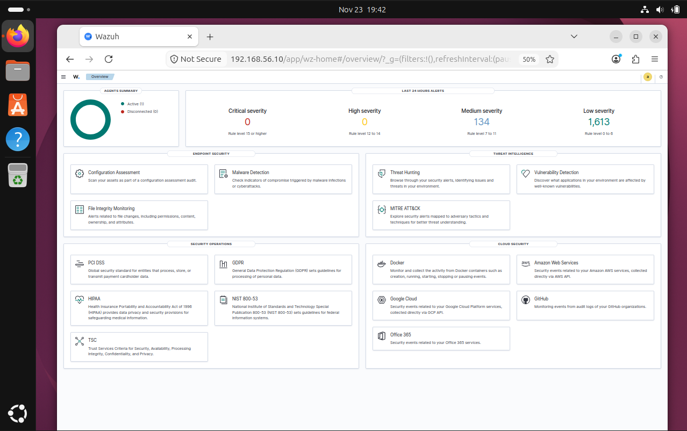
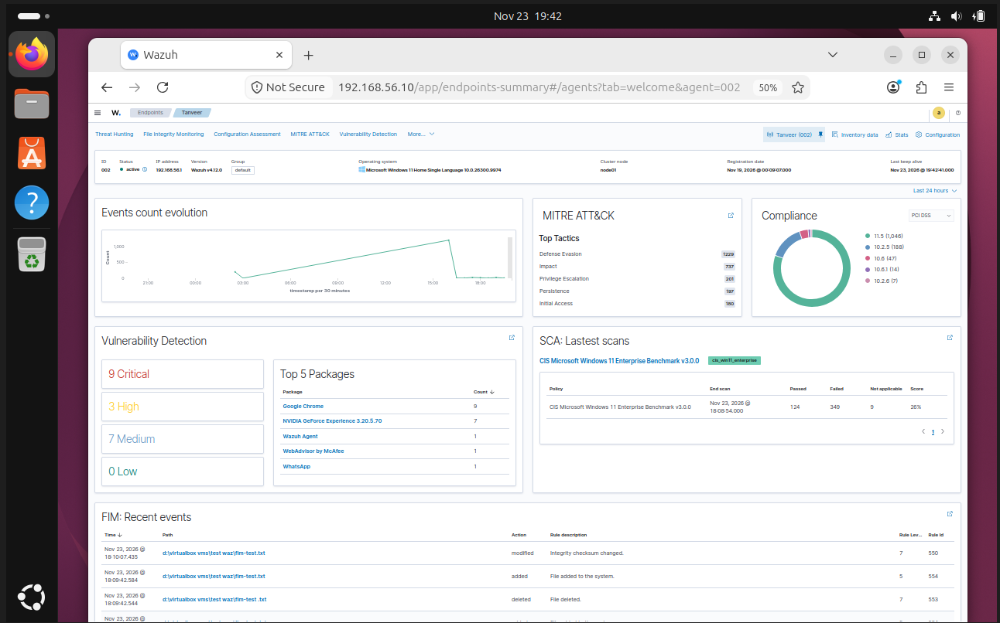
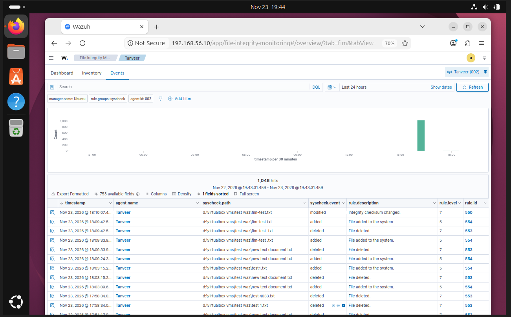
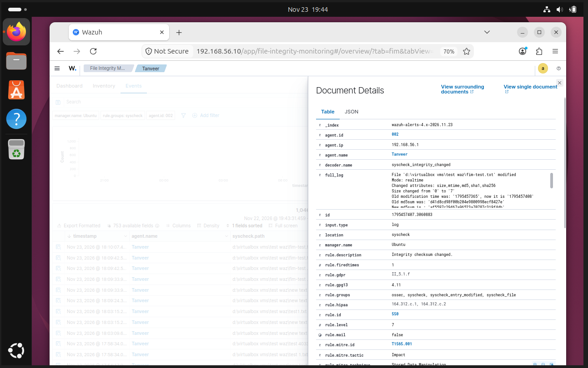

 Wazuh SOC Home Lab

 Overview

This project documents a hands-on Security Operations Center (SOC) home lab built using Wazuh, Ubuntu, Windows, Kali Linux, and VirtualBox.

The goal of the lab is to gain practical experience with SIEM monitoring, endpoint security, file integrity monitoring, security alerts, attack simulation, and incident investigation.

 Lab Environment

- **Wazuh Manager:** Ubuntu Linux VM
- **Monitored Endpoint:** Windows 11
- **Attacker Machine:** Kali Linux VM
- **Virtualization:** Oracle VirtualBox
- **SIEM/XDR Platform:** Wazuh

 Lab Architecture

```text
                    VirtualBox Lab

        Ubuntu / Wazuh Server
           192.168.56.10
                 |
                 |
        ---------------------
        |                   |
 Windows Endpoint       Kali Linux
 192.168.56.1           Attacker VM
        |
    Wazuh Agent
        |
        v
 Log Collection
 File Integrity Monitoring
 Security Alerts
 SOC Investigation
```

 Completed Tasks

- Installed and configured the Wazuh server on Ubuntu
- Configured a private VirtualBox lab network
- Installed the Wazuh agent on Windows
- Connected the Windows endpoint to the Wazuh manager
- Configured File Integrity Monitoring (FIM)
- Detected file creation events
- Detected file modification events
- Detected file deletion events
- Investigated FIM events through the Wazuh dashboard

 File Integrity Monitoring

A Windows test directory was configured for real-time monitoring:

```text
D:\VirtualBox VMs\test Waz
```

The Wazuh agent successfully detected file activity including:

- File added
- File modified
- File deleted
- Integrity checksum changed

These events were forwarded to the Ubuntu Wazuh manager and investigated through the Wazuh File Integrity Monitoring dashboard.

 Current Progress

The core Wazuh SIEM and File Integrity Monitoring lab is operational.

The next phase of the project will introduce Kali Linux to generate controlled security activity within the isolated lab environment.

Planned work includes:

- Kali Linux attacker integration
- Controlled attack simulation
- Security alert generation
- Threat hunting
- Alert investigation
- SOC incident analysis
- MITRE ATT&CK mapping

 Skills Demonstrated

- Wazuh SIEM/XDR
- Security monitoring
- File Integrity Monitoring
- Windows endpoint monitoring
- Linux administration
- VirtualBox networking
- Log analysis
- SOC alert investigation
- Troubleshooting
- Cybersecurity home lab design

## Disclaimer

All security testing in this project is performed only inside a controlled personal lab environment for educational purposes.

## Screenshots and Results

### Wazuh Dashboard Overview

The Wazuh dashboard confirms that the Windows endpoint is actively connected to the Ubuntu Wazuh manager and security events are being collected.



### Windows Endpoint Monitoring

The Windows endpoint is monitored through the Wazuh agent, providing visibility into endpoint security events, vulnerability information, MITRE ATT&CK mappings, and File Integrity Monitoring activity.



### File Integrity Monitoring

Real-time File Integrity Monitoring was configured for the following Windows directory:

```text
D:\VirtualBox VMs\test Waz
```

Wazuh successfully detected file creation, modification, and deletion events.



### FIM Alert Investigation

Individual Wazuh events were investigated to review details such as the monitored file path, event type, integrity checksum changes, rule level, rule ID, and agent information.


